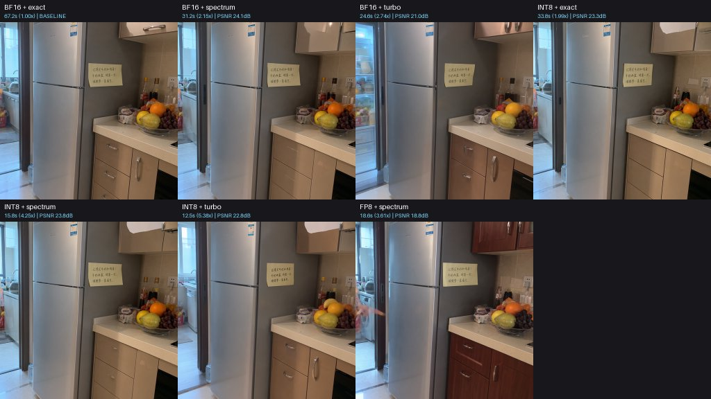

# MOSS-Image AMD ROCm 高性能部署与加速套件

面向 **AMD Instinct 数据中心卡（ROCm / CDNA 3，例如魔搭社区免费 192G AMD GPU Notebook）** 的 [OpenMOSS/MOSS-Image-SFT](https://modelscope.cn/models/openmoss/MOSS-Image-SFT) 完整推理与远程 API 部署方案。

无需下载第三方量化权重、无需 ComfyUI，直接在官方原版 `MOSS-Image-SFT` 权重上通过 **INT8-ConvRot（Hadamard 旋转量化）+ Spectrum 切比雪夫特征预测 + 单次共享 `torch.compile`** 实现 **4.25× ~ 5.38× 实测提速**，并附带 **OpenAI 兼容 HTTP API 服务**。

---

## 1. 实测性能对比

**测试环境**：魔搭社区免费实例 `DSW-AMD`（23 核 CPU / 200 GB 内存 / 191.7 GB 显存 AMD CDNA 3 GPU，镜像 `ubuntu22.04-rocm7.2.3-py312-torch2.12.0-1.40.1`）。

### 底层硬件算力实测（`4096 × 3072 × 9216` GEMM）

| 精度 | 底层接口 | 实测算力 | 单次耗时 | 相对 BF16 |
| :--- | :--- | :---: | :---: | :---: |
| BF16 | `F.linear` | 169.0 TFLOPS | 1.37 ms | 1.00× |
| FP8 (`float8_e4m3fnuz`) | `torch._scaled_mm` | 304.1 TFLOPS | 0.76 ms | 1.80× |
| **INT8** | **`torch._int_mm`** | **314.9 TFLOPS** | **0.74 ms** | **1.86×** |

*(同环境下 `[1, 24, 8360, 128]` BF16 注意力实测：`FLASH_ATTENTION` 8.36 ms/层 vs `MATH` 63.77 ms/层。)*

### 7 个版本同图同种子实测（`1024×1024` / 50 步 / CFG 3.0 / `seed=42`）

| 版本 | 单张耗时 | 提速倍率 | PSNR（对比 BF16 原版） | 适用场景与评价 |
| :--- | :---: | :---: | :---: | :--- |
| `BF16 + exact` | 67.2s | 1.00× | 基准 | 原版 50 步满算基准 |
| `BF16 + spectrum` | 31.2s | 2.15× | **24.1 dB** | 零量化损失 + 跳步加速 |
| `BF16 + turbo` | 24.6s | 2.74× | 21.0 dB | 零量化快速抽卡（背景偶有轻微偏移） |
| `INT8 + exact` | 33.8s | 1.99× | **23.3 dB** | 50 步满算直接快 2 倍，细节与原版高度一致 |
| **`INT8 + spectrum`（默认推荐）** | **15.8s** | **4.25×** | **23.8 dB** | **速度与画质双料冠军**，构图、色彩与中文文字均稳定 |
| `INT8 + turbo` | **12.5s** | **5.38×** | **22.8 dB** | 极速抽卡构图，画质与速度均优于 `BF16 + turbo` |
| `FP8 + spectrum`（不推荐） | 18.6s | 3.61× | 18.8 dB | 比 INT8 更慢，且易出现明显偏色/语义漂移 |



---

## 2. 核心优化技术栈

所有优化封装在 `opt_moss.py` 中，无需修改原始模型文件：

1. **实时 INT8-ConvRot（64 维 Hadamard 正交旋转 + 逐 Token / 逐通道动态 INT8）**
   - 利用正交矩阵性质 $(X H)(W H)^T = X W^T$，在启动加载权重时对 42 层 DiT 的线性权重一次性完成 64 维块 Hadamard 旋转并按输出通道量化为 `int8`；
   - 推理时对激活做同样旋转与逐 Token 动态 `int8` 量化，调用 `torch._int_mm` 跑满 **314.9 TFLOPS**，同时保留 Qwen3.5-9B 文本编码器（BF16）、输入/输出头（BF16）和 FLUX.2 VAE（FP32）原精度，避免文字糊边。
2. **Spectrum 切比雪夫隐状态预测（`arXiv:2603.01623`）**
   - 对正向/负向分支分别维护最近 8 步的 DiT 末层隐状态历史，通过岭回归切比雪夫多项式 + 线性外推混合预测中段步数特征并直接送入时间步调制的输出头；
   - `spectrum` 模式实算 `23/50` 步（跳过 27 步），`turbo` 模式实算 `18/50` 步（跳过 32 步），且用 `numpy.linalg.solve` 求解 5×5 小矩阵，规避部分 ROCm PyTorch 镜像缺少 CPU LAPACK 的问题。
3. **42 层共享单次 `torch.compile` + 隔离 FlashAttention SDPA**
   - 合并每层 `Q/K/V` 为单一宽矩阵 `W_qkv`；
   - 将 42 个同构 DiT 层拆成 `_pre_attn`（编译） + 原生 `F.scaled_dot_product_attention`（不进编译） + `_post_attn`（编译）并**共享同一组编译函数**，冷启动编译从数分钟缩短到 **6~16 秒**，编译缓存持久化于 `.inductor_cache/`。
4. **重复计算消除与 ROCm 稳定性加固**
   - 单张图 50 步内缓存不变的 `RoPE` 和 2 层 `text_embedder`；跨图缓存负面提示词编码；
   - 在实际计算步末尾显式调用 `torch.cuda.synchronize()`，彻底消除 ROCm 异步任务队列堆积导致的第 26 步 `Segmentation fault`。

---

## 3. 目录结构

```text
moss-image-amd-deploy/
├── README.md        # 本文档
├── opt_moss.py      # 核心加速引擎（INT8-ConvRot / FP8 / BF16 + Spectrum + 共享编译）
├── chat_moss.py     # 终端交互式出图工具（支持 /mode /size /batch /bench 等指令）
├── api_server.py    # Web UI + OpenAI 兼容 FastAPI 服务（单端口二合一，带密钥鉴权与并发锁）
├── web/index.html   # 内置中文暗色响应式 Web 画图工作台（适配电脑/手机浏览器）
├── gradio_ui.py     # 可选 Gradio WebUI（支持 share=True 免穿透公网链接）
├── compare_all.py   # 7 版本自动对比测速与 7 宫格拼图脚本
├── start.sh         # 一键启动交互式出图（自动检查依赖与下载模型）
├── start_api.sh     # 一键启动内置 Web UI + OpenAI API 服务（推荐）
└── start_gradio.sh  # 一键启动 Gradio WebUI（免穿透备选）
```

---

## 4. 快速开始（以魔搭社区免费 AMD 192G Notebook 为例）

### 第 1 步：启动实例
1. 打开魔搭社区 **我的 Notebook**，选择 **`AMD GPU环境`**（23 核 / 200 GB 内存 / 192 GB 显存，预装镜像 `ubuntu22.04-rocm7.2.3-py312-torch2.12.0-1.40.1`）并点击 **启动**。
2. 进入新版 **Code Editor** 后，点击底部面板的 **「终端」**（所有持久化文件请放在 `/mnt/workspace/` 下）。

### 第 2 步：拉取本项目并一键启动
在终端里直接克隆到持久化目录 `/mnt/workspace/moss-image` 并启动：

```bash
cd /mnt/workspace
git clone https://github.com/TTWParty/moss-image-amd-deploy.git moss-image
cd moss-image
bash start.sh
```

> **提示**：如果无法直连 GitHub，也可以在本地下载 ZIP 后直接拖入 Code Editor 左侧 `DSW-AMD (/mnt/workspace)` 中解压，不要把几百行代码通过 `cat << 'EOF'` 直接粘贴进网页终端（网页终端粘贴过长容易被缓冲区截断）。

`start.sh` 会自动完成：
1. 检查并补齐缺失的 Python 依赖（使用 `--upgrade-strategy only-if-needed`，**绝不覆盖预装 ROCm PyTorch**）；
2. 若当前目录不存在 `MOSS-Image-SFT`，自动通过 `modelscope download` 走内网高速下载 `openmoss/MOSS-Image-SFT`；
3. 加载模型至显存、完成 2 步编译预热，进入交互式提示词输入界面。

### 可选启动参数

```bash
bash start.sh              # 默认：INT8-ConvRot + Spectrum（15.8s / 张，最推荐）
bash start.sh --bf16       # 零量化原版 BF16 + Spectrum（31.2s / 张）
bash start.sh --fp8        # AMD FP8 模式（仅作对比测试，不推荐）
bash start.sh --no-compile # 关闭 torch.compile（调试用）
```

### 交互模式常用命令

进入 `提示词>` 后直接输入中英文描述按回车即可出图（结果自动按时间戳存入 `outputs/`，在左侧单击即可预览和下载），支持以下实时指令：

| 指令 | 作用 |
| :--- | :--- |
| `/mode spectrum` | 切换至 4.25× 平衡加速模式（默认推荐） |
| `/mode turbo` | 切换至 5.38× 极速抽卡模式（约 12.5s / 张） |
| `/mode exact` | 切换至 50 步无跳步满算模式（约 33.8s / 张） |
| `/size 896x1152` | 修改分辨率（宽高必须是 16 的正整数倍，如 `1024x1024`、`1456x1456`、`1280x720`） |
| `/batch 4` | 单次输入连续生成 4 张不同种子的图 |
| `/cfg 4.5` | 调整引导强度（长提示词建议 `3.0`，短提示词建议 `4.0~5.5`） |
| `/steps 50` | 修改推理步数（官方推荐 ≥ 50） |
| `/seed 42` | 固定随机种子（输入 `/seed random` 恢复随机） |
| `/neg 负面词` | 设置负面提示词（仅输入 `/neg` 清空） |
| `/bench` | 一键跑 `1456×1456` 和 `1024×1024` 标准测试图 |
| `/quit` | 退出程序 |

### 运行 7 版本对比测速（可选）

```bash
TORCHINDUCTOR_CACHE_DIR=/mnt/workspace/moss-image/.inductor_cache \
python /mnt/workspace/moss-image/compare_all.py
# 加 --1456 可测试 1456x1456 高清分辨率
```

结果图与 7 宫格对比图会保存在 `compare/compare_grid_1024.png`。

---

## 5. 远程 Web UI 与 API 部署调用

提供 **2 种远程使用方式**，均默认开启 **INT8-ConvRot + Spectrum（15.8s/张）** 加速并内置 GPU 并发锁：

### 方式一（推荐）：内置 Web UI + OpenAI API 二合一（`start_api.sh`）
无需安装 Gradio，启动后在**同一个 `8000` 端口**同时提供：
- **中文响应式 Web 画图工作台**（访问 `https://你的公网域名/`，手机/电脑浏览器直接打开）：
  - **服务器持久化历史图库**：自动将生成图片与完整参数（Prompt / 种子 / CFG / Shift / SLG）落盘到 `outputs/` 并缓存缩略图，**刷新网页不丢失**，支持点击放大原图、一键回填全部参数与删除旧图；
  - **异步任务队列 + 实时步数进度条 + 中途取消**：实时显示当前阶段（编码提示词 → 第 `X/50` 步 → VAE 解码），支持随时点「取消」在当前步结束后立即中止，同时**彻底规避 Cloudflare 免费隧道 100 秒 524 超时问题**；
  - **高级参数折叠面板**：支持调节 `Scheduler Shift` 与 `SLG 跳层（uncond_skip_layers，含 22/24/26/关闭预设）`，以及一键防拼图词、画幅预设、批量出图与 API Key 浏览器记忆。
- **OpenAI 兼容接口**（`POST /v1/images/generations`）与 **直出 PNG 接口**（`POST /generate`）。

#### 第 1 步：启动服务（终端 1）

```bash
cd /mnt/workspace/moss-image
MOSS_API_KEY="换成你自己的密钥" MOSS_PORT=8000 bash start_api.sh
```

环境变量说明：
- `MOSS_API_KEY`：访问密钥（强烈建议自定义；在网页左上角输入框填一次即可自动保存，API 客户端通过 `Authorization: Bearer <KEY>` 或 `x-api-key` 传递）；
- `MOSS_PRECISION`：可选 `int8`（默认）/ `bf16` / `fp8`；
- `MOSS_PORT`：监听端口，默认 `8000`；
- `MOSS_SAVE_OUTPUTS`：默认 `1`，自动同步保存生成图片到 `outputs/`；
- `MOSS_MODEL_DIR`：自定义模型权重目录（默认为脚本同级 `MOSS-Image-SFT`）。

#### 第 2 步：公网暴露端口（终端 2）

魔搭免费 Notebook 容器无独立公网 IP，新开一个终端窗口任选其一将 `8000` 端口映射到外网，拿到 `https://...` 地址后**直接在浏览器打开即可画图**：

- **选项 A：自有云服务器 SSH 反向隧道（国内直连最稳最快）**
  ```bash
  ssh -N -R 0.0.0.0:8000:127.0.0.1:8000 root@你的服务器IP
  ```
  *(需在自有服务器 `/etc/ssh/sshd_config` 中开启 `GatewayPorts yes` 并放行 8000 端口。)*

- **选项 B：`cpolar` / `ngrok` 内网穿透**
  安装对应客户端并配置 token 后执行映射（如 `./ngrok http 8000` 或 `cpolar http 8000`）。

- **选项 C：Cloudflare Quick Tunnel（免注册，需能连通 Cloudflare）**
  ```bash
  curl -L https://github.com/cloudflare/cloudflared/releases/latest/download/cloudflared-linux-amd64 -o /mnt/workspace/cloudflared
  chmod +x /mnt/workspace/cloudflared
  /mnt/workspace/cloudflared tunnel --url http://127.0.0.1:8000
  ```

---

### 方式二（免配穿透备选）：Gradio 一键公网链接（`start_gradio.sh`）
如果你手头没有云服务器、也不想装 `cpolar`/`cloudflared`，可以直接用 Gradio 自带的 `share=True` 生成 72 小时免费公网网页链接（建议同时设置账号密码防白嫖）：

```bash
cd /mnt/workspace/moss-image
MOSS_UI_AUTH="admin:换成你的密码" bash start_gradio.sh
```

启动完成后终端会打印 `Running on public URL: https://xxxxxx.gradio.live`，手机/电脑浏览器直接打开即可使用（同时支持 `gradio_client` 远程调用）。

---

### 第 3 步：程序化 API 调用示例（配合方式一）

#### 接口一览
- `GET /`：内置中文 Web 画图工作台
- `GET /health`：健康检查（无需鉴权）
- `POST /v1/images/generations`：OpenAI 兼容生图接口（返回 `b64_json`、种子和耗时）
- `POST /generate`：直接返回 `image/png` 二进制图片流

#### `curl` 一行出图

```bash
curl -X POST "https://你的公网域名/generate" \
  -H "Authorization: Bearer 换成你自己的密钥" \
  -H "Content-Type: application/json" \
  -d '{"prompt":"一只橘猫坐在窗台上看雪，单张完整照片","size":"896x1152","mode":"spectrum","cfg":4.0}' \
  -o out.png
```

#### Python `openai` SDK 调用（同样适用于 Cherry Studio / Dify 等客户端）

```python
import base64
from openai import OpenAI

client = OpenAI(base_url="https://你的公网域名/v1", api_key="换成你自己的密钥")
resp = client.images.generate(
    model="moss-image-sft",
    prompt="一只橘猫坐在窗台上看雪，单张完整照片",
    size="896x1152",
    extra_body={
        "mode": "spectrum",
        "cfg": 4.0,
        "negative_prompt": "collage, grid, split screen, multi-panel, worst quality",
    },
)
with open("out.png", "wb") as f:
    f.write(base64.b64decode(resp.data[0].b64_json))
```

---

## 6. 出图参数与防拼图建议

1. **避免多宫格/分屏拼图**：MOSS-Image-SFT 强化了多格排版与海报能力，在 `1024×1024` 正方形 + 短提示词 + 空负面词下较容易抽到多宫格拼图。推荐组合：
   - 人像改用竖屏比例：`/size 896x1152` 或 `/size 832x1216`；
   - 添加负面词：`/neg collage, grid, split screen, multi-panel, multiple views, diptych, triptych, border, frame, worst quality, bad anatomy`；
   - 短提示词将 `/cfg` 提高到 `4.0~5.5`，并在提示词中写清构图与主体（如“单张完整近景照片，画面中央只有一位……”）。
2. **中文长文本排版**：在提示词中用 `\n` 或换行明确分行；极高密度文字精修时可将分辨率提高至 `1456×1456` 并临时切到 `/mode exact`。

---

## 7. 常见问题与避坑记录（FAQ）

1. **重启魔搭实例后需要重新下载模型吗？**
   不需要。只要项目和模型放在 `/mnt/workspace/` 下，关机重启都会持久化保留；重启后系统 `pip` 环境可能重置，直接重新运行 `bash start.sh` 或 `bash start_api.sh` 即可在十几秒内自动补装缺失依赖。
2. **为什么不能直接 `pip install -r requirements.txt`？**
   原仓库要求 `torch>=2.9`，直接全量安装可能把镜像预装的 ROCm 版 PyTorch 覆盖成 CUDA 版，导致识别不到 AMD 显卡。务必按 `start.sh` 仅安装缺失库并保留 `+rocm` / 预装 PyTorch。
3. **不跑模型时记得停机**
   魔搭免费实例单次最长运行 8 小时、总计 100 小时免费额度；用完请在页面右上角 **「实例运行中」→「停止实例」** 停止计费。
4. **为什么不推荐在本机上开 `FP8`？**
   一方面 AMD CDNA 3 原生 FP8 格式为 `float8_e4m3fnuz`（非 NVIDIA 的 `e4m3fn`），另一方面在 MOSS-Image 上普通每张量 FP8 实测不仅比 INT8-ConvRot 更慢（18.6s vs 15.8s），还会产生明显偏色和画质退化（PSNR 18.8 dB vs 23.8 dB）。
5. **终端卡在运行中按 `Control + C` 关不掉？**
   底层 C++/ROCm 扩展运行期间可能不响应 `SIGINT`，可按 **`Control + \`** 强制终止，或新开终端执行 `pkill -9 -f python`。
